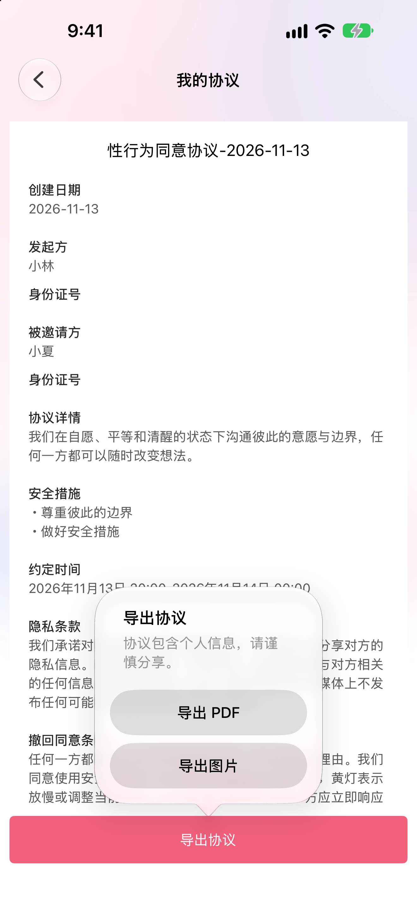

# 性同意

一个使用 Swift 和 UIKit 开发的 iOS 项目，帮助双方记录亲密行为前的意愿、边界与安全措施。

同意应当自愿、明确并持续存在，任何一方都可以随时撤回。书面记录不能替代实时沟通，项目不提供法律意见，也不能保证记录具有法律效力。

## 界面

| 首页 | 创建协议 | 协议列表 | 导出选项 |
| --- | --- | --- | --- |
|  |  |  |  |

列表和导出截图使用虚构数据。

## 功能

- 创建协议，填写双方信息、约定时间、边界和安全措施。
- 查看和删除本地协议记录。
- 将协议导出为多页 PDF 或 PNG 长图，通过系统分享面板处理。

## 运行

需要 Xcode 16 或更新版本、CocoaPods，以及 iOS 15 或更新版本。

```bash
pod install
open sexual.xcworkspace
```

在 Xcode 中选择 `sexual` scheme 和模拟器运行。真机运行需要配置自己的开发团队和 Bundle Identifier。依赖版本记录在 `Podfile.lock`；首次安装依赖需要网络连接。

## 数据与隐私

协议记录使用设备本地 UserDefaults 保存，当前没有专门的加密存储或账号同步。删除应用可能导致记录丢失；请谨慎填写姓名、身份证号等敏感信息。

导出时应用会在临时目录生成文件，然后调用系统分享面板。分享或保存后的文件由所选目标管理；请确认接收方和保存位置。导出临时文件目前没有主动清理机制。

## 验证情况

项目曾在 iOS 27 模拟器构建和启动；长文本导出测试生成了多页 PDF 和 PNG。iOS 26、真机以及系统分享后的保存流程尚未完成全面验证。

## 许可证

本项目采用 [MIT License](LICENSE)。第三方依赖遵循各自的许可证。
